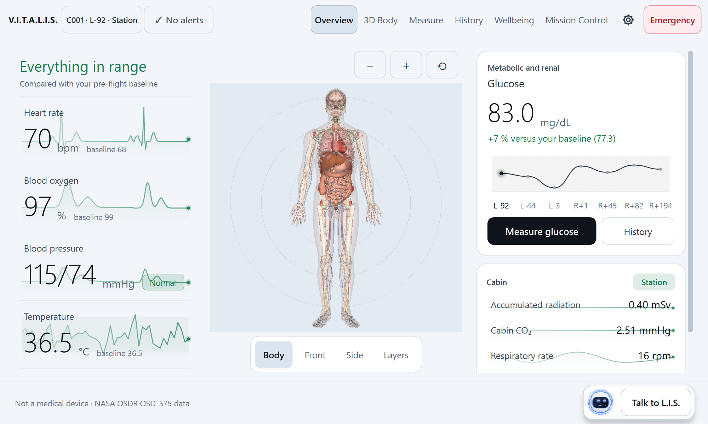
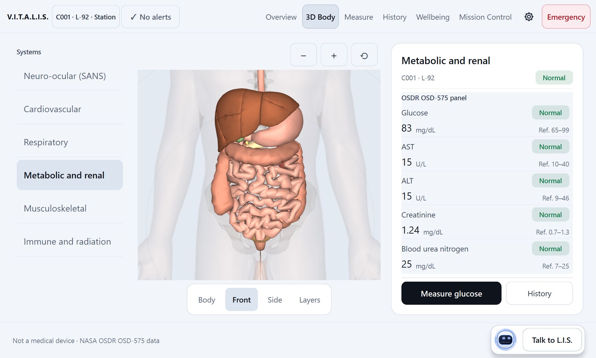
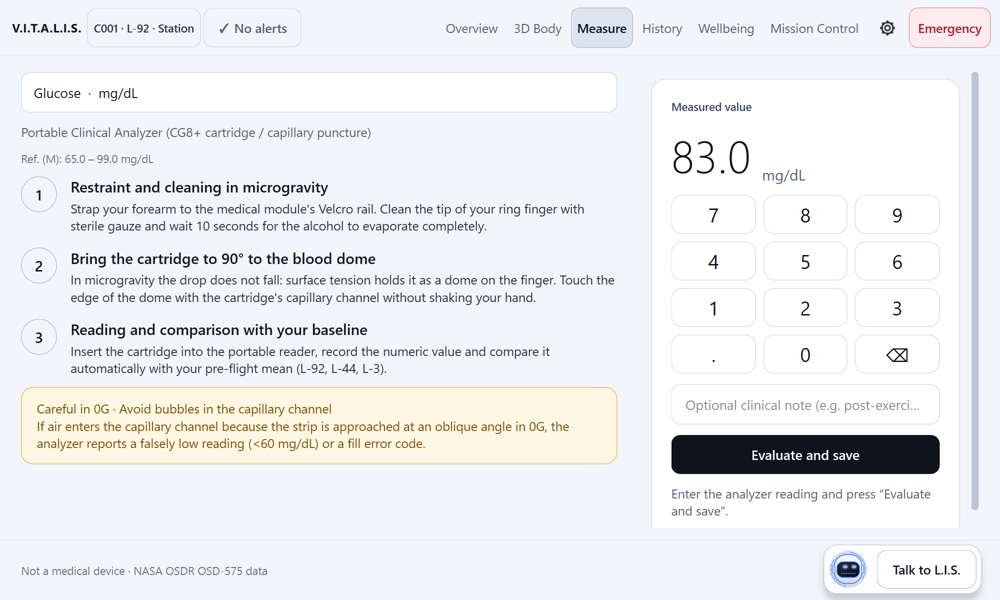
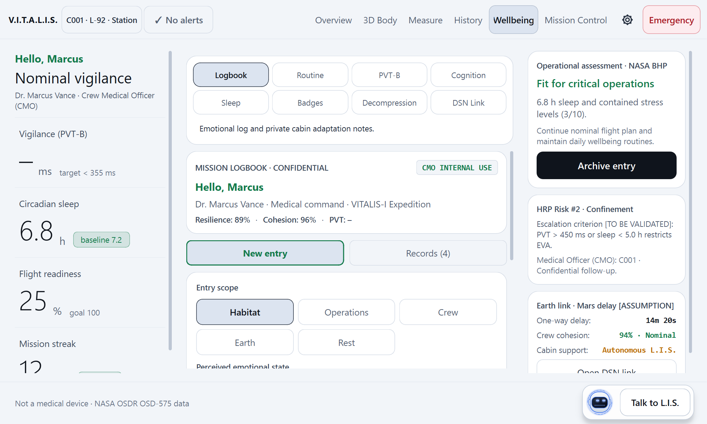
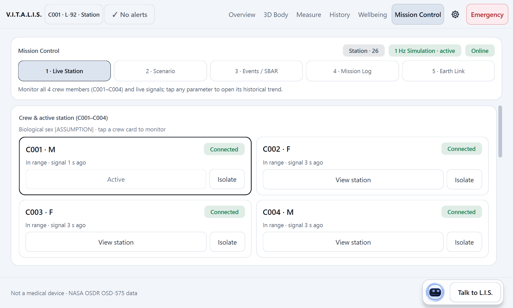

# V.I.T.A.L.I.S. — Vital Information Telemetry and Life-support In Space

**An offline-first health-monitoring desktop application that lets astronauts assess their own health on long space missions and act on it — including when no doctor on Earth can answer in time.**

> Team **ROCKET** · NASA International Space Apps Challenge 2026 · Local Event Tuxtla Gutiérrez, Chiapas, México
> Challenge: *Create Health Monitoring Software for Astronauts on Space Missions* (Brazilian Space Agency / AEB)
> **Not a medical device.** V.I.T.A.L.I.S. does not diagnose, prescribe or replace a flight surgeon. See [Clinical safety](#clinical-safety).

| Overview (live vitals + 3D body) | 3D Body (organ-level triage) | Measure (guided, touch keypad) |
|---|---|---|
|  |  |  |
| **Wellbeing (NASA BHP)** | **Mission Control** | **Emergency protocols** |
|  |  |  |

---

## The problem

On a Mars transit, one-way communication with Earth takes up to ~22 minutes. Astronauts are not doctors, yet when a crewmate shows chest pain the crew must decide alone. NASA's Human Research Program groups spaceflight risks into five hazards — **space radiation, isolation and confinement, distance from Earth, gravity fields, and hostile/closed environments** — and the challenge asks for a *visual tool that helps astronauts assess their own health and provides guidance on treatments and health improvements*.

## What V.I.T.A.L.I.S. does

1. **Guided measurement.** For each indicator the app explains *how to measure it in microgravity*, why it matters, and which failure modes give a false reading (e.g. air bubbles in a capillary cartridge at 0 g).
2. **Personal baseline.** Readings are compared against each astronaut's own trajectory, built from **NASA OSDR study OSD-575** (Inspiration4 comprehensive metabolic panel, crew C001–C004, timepoints L-92 … R+194), not only against population ranges.
3. **Deterministic traffic-light triage.** A pure, unit-tested Python rules engine (`backend/triage.py`) returns *level · reason · rule · action · source* for every value. No generative model ever produces a number.
4. **Interactive 3D body.** A VTK/OpenGL viewer with **172 anatomical meshes**; organs with out-of-range indicators pulse in their triage colour and can be touched for details.
5. **L.I.S. (Life-support In Space).** A floating on-device assistant that is grounded on the local data, remembers each astronaut, speaks English/Spanish, can drive the whole app by voice or text, warns calmly on *yellow* and urgently on *red*, and can request help. A strict validator rejects any number it was not given, and a deterministic fallback works with no network.
6. **Emergency mode.** Step-by-step protocols with a CPR metronome, procedural ALSP animations (AED, IV access, airway, drugs), an intermittent (non-alarming) red-state sound alarm, SBAR reports and a prioritised **A > B > C > D** queue to Earth with chained hashes.
7. **Wellbeing (NASA Behavioral Health & Performance).** Mission logbook, daily routine, PVT-B reaction test, Stroop cognition battery, sleep/circadian hygiene, badges, guided 4-4-4-4 decompression with Earth soundscapes, and a DSN link with simulated Earth–Mars delay.
8. **Mission Control.** Station and crew state at 1 Hz (simulated or OSD-575 replay), scenario injection, events/SBAR, mission log and the Earth sync queue.
9. **Fully touch-first, dark/light, bilingual (EN/ES) and offline** — SQLite on the crew workstation, no cloud.
10. **Runs on an Android tablet** as a remote touch screen of the very same app ([`tablet/`](tablet/README.md)).

## Quick start

Requirements: Windows 10/11 (developed and tested there), Python ≥ 3.11 (3.13 tested), a GPU with OpenGL 3.2+.

```bash
git clone https://github.com/Charcraft/vitalis-astronaut-health.git
cd vitalis-astronaut-health
pip install -r requirements.txt
python vitalis_desktop.py          # opens the desktop app (or double-click run-vitalis.bat)
```

Useful commands:

```bash
python vitalis_desktop.py --version                     # V.I.T.A.L.I.S. 1.2.0
python vitalis_desktop.py --test-init                   # headless start-up check of all subsystems
python -m unittest tests/test_new_backend_integration.py -v   # backend, triage, DB, Earth sync, BHP, touch UX
python -m unittest tests/test_tablet.py -v                    # tablet bridge: touch, text, audio, protocol
python scripts/auditoria_tablet.py                      # layout/touch audit of every view at tablet size
python scripts/normalizar-osdr.py                       # re-download and normalise NASA OSD-575
```

The local API (`FastAPI`, `127.0.0.1:8780`) starts with the app and exposes `/api/parameters`, `/api/triage`, `/api/telemetry/hub`, `/api/series`, `/api/episodios`, `/api/tierra`, `/api/export`, …

### On an Android tablet

Enable USB debugging, connect the tablet and run `run-vitalis-tablet.bat` (or `python vitalis_tablet.py`). The app keeps running on the PC; the tablet becomes its touch screen, keyboard, speaker and microphone. Details, measurements and limits: [`tablet/README.md`](tablet/README.md).

## Documentation

| Document | What it explains |
|---|---|
| [`docs/ARCHITECTURE.md`](docs/ARCHITECTURE.md) | How the application works end-to-end (modules, data flow, triage, L.I.S., Earth sync, tablet bridge) |
| [`docs/TECH_STACK.md`](docs/TECH_STACK.md) | Every technology used, why, and what we deliberately did not use |
| [`docs/DATA_SOURCES.md`](docs/DATA_SOURCES.md) | NASA data used, other references, 3D model licences |
| [`docs/INDICATORS.md`](docs/INDICATORS.md) | The 15 clinical indicators, thresholds and their validation status |
| [`docs/AI_USE.md`](docs/AI_USE.md) | How Super Intelligence (SI) tools were used and what was never delegated |
| [`docs/prompts/`](docs/prompts/README.md) | **The prompts used with each AI harness during the hackathon, in order**, and the structure each one produced |
| [`docs/SUBMISSION_CONTENT.md`](docs/SUBMISSION_CONTENT.md) | The project-page answers prepared for the NASA Space Apps form (nothing has been submitted by this repository) |
| [`CHANGELOG.md`](CHANGELOG.md) | Release history |

## Repository layout

```
vitalis_desktop.py      Desktop entry point (starts runtime, local API and the Qt app)
vitalis_tablet.py       Tablet entry point (same app, remote touch screen)
backend/                Triage engine, SQLite layer, 1 Hz runtime, Earth sync, L.I.S. agent, FastAPI
desktop/                PySide6 UI: views, 3D viewer, widgets, voice engine, i18n (en/es)
tablet/                 Remote-display bridge for Android tablets
recursos/datos/         seed (real NASA OSD-575), knowledge (protocols, guides), mock (cabin sensors)
recursos/modelos/       3D model catalogue, attribution and licences
tests/  scripts/        Automated tests and utilities (OSDR pipeline, tablet audit)
docs/                   English documentation and screenshots
```

## Clinical safety

- The tool **never diagnoses, never names a drug or dose as advice, and is not a medical device.** The disclaimer is permanently visible in the app footer.
- Every numeric threshold either cites a source (see [`docs/INDICATORS.md`](docs/INDICATORS.md), [`docs/DATA_SOURCES.md`](docs/DATA_SOURCES.md)) or is explicitly tagged **`[TO BE VALIDATED]`** (shown as `[POR VALIDAR]` in the Spanish sources/UI), **`[ASSUMPTION]`** or **`[INFERENCE]`**.
- Only de-identified public data are used (OSD-575 crew are anonymised as C001–C004 by the source).

## Credits and licences

Code: MIT ([`LICENSE`](LICENSE)). 3D anatomy: CC BY 4.0 with upstream credits in [`recursos/modelos/ATTRIBUTION.md`](recursos/modelos/ATTRIBUTION.md). NASA OSDR data are public. This project does not use NASA logos or mission identifiers. AI-assisted work is disclosed in [`docs/AI_USE.md`](docs/AI_USE.md).
